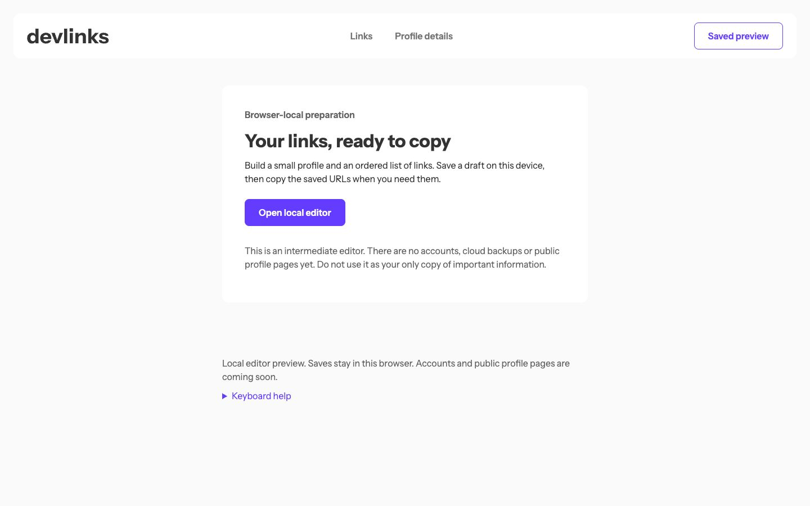

# Frontend Mentor - Link-sharing app solution

This is a solution to the [Link-sharing app challenge on Frontend Mentor](https://www.frontendmentor.io/challenges/linksharing-app-Fbt7yweGsT). The app lets you edit a profile, save an ordered list of links in your browser, and copy the saved URLs.

## Table of contents

- [Overview](#overview)
  - [The challenge](#the-challenge)
  - [Screenshot](#screenshot)
  - [Links](#links)
- [My process](#my-process)
  - [Built with](#built-with)
  - [What I learned](#what-i-learned)
  - [Continued development](#continued-development)
- [Run it locally](#run-it-locally)
- [Author](#author)

## Overview

### The challenge

Users should be able to:

- Add, edit, and remove links, choosing a platform for each one.
- Reorder links by dragging or using the Move up and Move down buttons.
- See validation errors for missing fields, invalid URLs, and URLs for the wrong platform.
- Add a first name, last name, optional email, and profile picture.
- Save profile details and links separately, then preview and copy saved links.
- Restore saved data after a reload and use the editor on mobile and desktop.
- Use the platform picker and reorder controls with a keyboard.

### Screenshot



### Links

- Solution URL: [My Frontend Mentor solution](https://www.frontendmentor.io/solutions/link-sharing-app-with-nextjs-typescript-and-tailwind--EtbqDnlqi)
- Live Site URL: [Devlinks local editor](https://link-sharing-app.royeradames.com)

## My process

### Built with

- Next.js App Router and React
- TypeScript
- Tailwind CSS and custom CSS
- TanStack Form
- Zod Mini for validation
- Royer UI Input and Combobox fields
- Browser localStorage and Web Locks
- Playwright for browser tests

### What I learned

I started with a Shoelace mock in May 2024. The old notes show how much time I spent on imports, SVG paths, and styling through the shadow DOM. The current app uses React fields and keeps its saved draft in the browser.

This was my first app to use the Royer UI Input and Combobox fields from my registry. I use Input for URLs and profile fields, and Combobox for the platform picker. I set the app's colours through CSS tokens and pass field errors into the shared controls.

I learned to keep saved values separate from the form draft. Each section saves on its own. Switching pages keeps unsaved edits, but the preview and Copy links use saved values. Web Locks serialize writes, and checking the stored draft before saving stops another tab from overwriting newer data.

Platform-specific URL validation is still my weakest part. I now require HTTPS and check the hostname against the selected platform. That catches the wrong platform and misleading domains, but it does not check whether the URL path points to a profile.

### Continued development

- Tighten platform-specific URL path checks beyond the current hostname validation.
- Compare the editor and preview against the full premium design stills when available. I cannot claim an exact visual match from the references I had.

## Run it locally

Use Node.js 24. Installs need no token.

```bash
npm ci
npm run dev
```

The development server runs at [http://127.0.0.1:3000](http://127.0.0.1:3000). Edit links at `/dashboard/links` and profile details at `/dashboard/profile-details`.

For checks:

```bash
npm test
npm run lint
npm run typecheck
npm run build
npm run test:browser
```

`npm test` checks validation, saved drafts, reordering, copy feedback, and the solution's dependency restrictions. After building, `npm run test:browser` starts its own production server at `127.0.0.1:4392`. It uses Chrome and covers persistence, keyboard and pointer actions, storage failures, conflicting tabs, images, clipboard failures, and responsive layouts. Set `PW_PORT` to use another port. Test data is synthetic.

This is a browser-local demo. Saved data stays under `devlinks.saved-draft.v1` on this browser origin. Changing pages keeps unsaved edits; reloading restores the saved version. Copy links copies saved URLs. Do not use this demo as your only copy of important information. Saved drafts are not encrypted, so anyone with access to this browser profile may read them.

Pictures must be valid PNG or JPEG files, at most 256 KB and 1024 × 1024 pixels. Saving reports an error if storage or Web Locks are unavailable. If a saved draft is unreadable, download its backup before explicitly resetting that one storage key.

I keep the historical five-link limit. It is an implementation limit, not a requirement I can confirm from the official brief. I retain the purple and white editor and preview layout, with a 16 px text floor. Full premium design stills were unavailable, so I do not claim an exact visual match.

The 37 historical image assets remain unchanged. I self-host Instrument Sans from Google Fonts with its original [OFL licence](./public/fonts/OFL.txt). The shared Input derives from shadcn/ui through Raul Gym; its MIT notice is in [Third party notices](./components/royer/THIRD_PARTY_NOTICES.md).

## Author

- Website - [Royer Adames](https://royeradames.com)
- Frontend Mentor - [@royeradames](https://www.frontendmentor.io/profile/royeradames)
